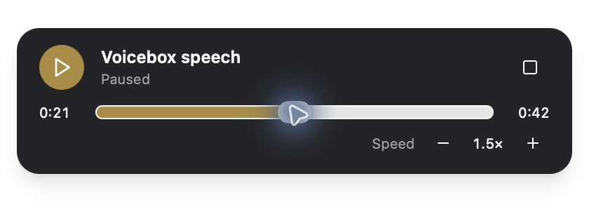

# Floating playback controls

When agent speech starts playing, Voicebox shows a floating player with elapsed and total time. Pause or resume, seek with the position slider, replay finished speech, or stop and dismiss the player. Keyboard arrow keys adjust the focused position slider. Finished speech remains visible for five seconds so it can be replayed; the recording also remains available in History.

The minus and plus buttons select a speech playback speed from 0.75× to 2×. The choice is saved locally and applied to subsequent agent recordings, including after restarting the app. Agent playback uses the browser's pitch-preserving media playback, without decoding or stretching the whole recording in JavaScript.

The widget also mirrors audio playing in the main waveform player. Commands control that existing audio source, rather than starting another copy. This path retains its existing WebAudio backend at normal speed; the widget shows speed as unavailable. Native device-routed playback does not support seeking, and stopping/starting that output restarts the recording rather than resuming at a saved position.

Capture/dictation controls take precedence while a capture is active. Showing the player does not change the application's close/server lifecycle. On macOS the window is shown without activating Voicebox and restores the previous application on dismissal if the player still owns focus.

## Scope

This feature uses the existing generation-status SSE and completed audio endpoints. It changes no backend routes, model configuration or generation behavior. A newer speech request still replaces the previous request, as it did before. Live PCM streaming, Speech Inbox, Reader and attention tracking are separate features.

## Validation

Run `bun run test:playback`, `bun run typecheck`, `bun run build:web`, and `bun run --cwd tauri build`. Playback tests run in the frontend CI job.

Before release, exercise the desktop app on supported platforms:

1. Send agent speech through MCP or `/speak`; wait for audio and its floating player.
2. Pause, seek using the pointer and keyboard, resume, change speed, and stop. Confirm audible playback and content time agree.
3. Let speech finish, replay within five seconds, and confirm no new generation is created. Open the existing recording from History after the overlay hides.
4. Change speed, send another request, restart the app, and confirm the saved speed still applies to agent speech.
5. Send a second request during playback; confirm the previous source stops and late callbacks cannot change the new player.
6. Play audio in the main player. Confirm the floating controls operate the same source, including replay and stop. For routed devices, confirm seeking/speed are unavailable and stop during setup cannot leave sound playing.
7. Start dictation while the player is visible. Confirm capture controls remain usable and text is pasted into the intended application.
8. On macOS, show, click and dismiss the widget while typing in another app. Confirm focus is not stolen on appearance or restored over a later user-selected app.
9. Close the main app with each existing keep-server-running setting and confirm existing platform-specific behavior is unchanged.
